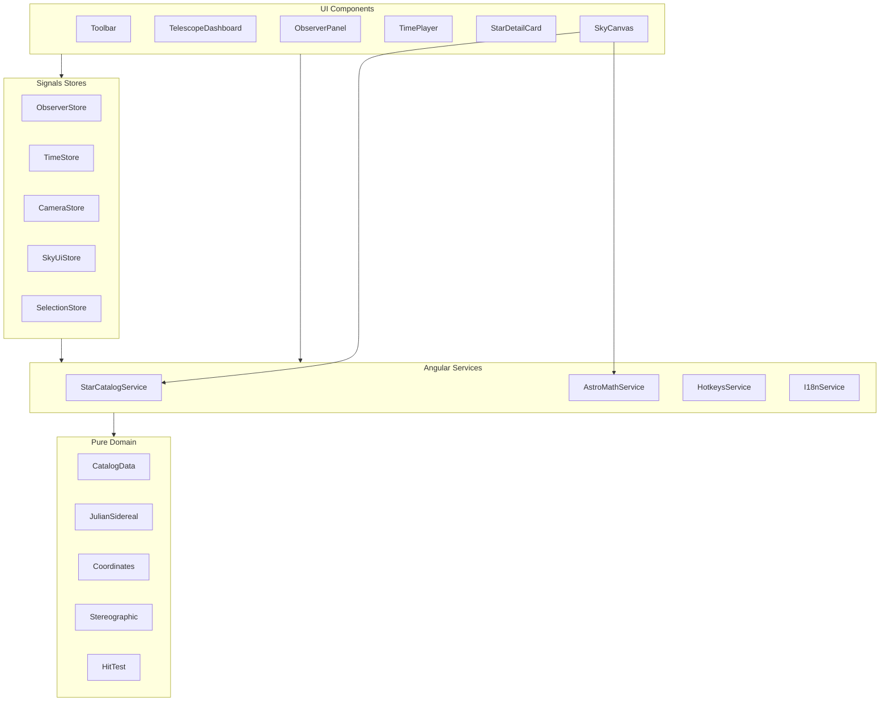

# 02 — Architecture (Angular 22+)

Создай приложение строго по этой архитектуре. Не сваливай сферическую математику в компоненты. Не используй NgRx/Akita — только Signals stores.

---

## 2.1 Стек и bootstrap

1. Создай проект Angular **latest stable ≥ 22**, standalone, SCSS (или SCSS + Tailwind), **без SSR**, **без** `@angular/router`.
2. Включи **zoneless**. Не добавляй `zone.js` обратно.
3. Prefix: `amp`.
4. Точка входа: `main.ts` → `bootstrapApplication(AppComponent, appConfig)`.
5. `app.config.ts`: `provideZonelessChangeDetection()` (или эквивалент актуального API); анимации панелей — CSS.

---

## 2.2 Дерево каталогов (обязательное)

```
src/
  index.html
  main.ts
  styles.scss
  app/
    app.component.ts
    app.component.html
    app.component.scss
    app.config.ts

    models/
      astronomy.types.ts          # RENAME-LOCKED (бриф)

    core/
      constants/
        astronomy.constants.ts
        time.constants.ts
        render.constants.ts
        location-presets.constants.ts
      models/
        theme.model.ts
        locale.model.ts

    domain/
      astronomy/
        angle.util.ts
        julian.util.ts
        sidereal.util.ts
        coordinates.util.ts
        stereographic.util.ts
        star-draw.util.ts
        hit-test.util.ts
        julian.util.spec.ts
        sidereal.util.spec.ts
        coordinates.util.spec.ts
        stereographic.util.spec.ts
      catalog/
        stars.data.ts
        constellations.data.ts
        star-catalog.ts

    state/
      observer.store.ts
      time.store.ts
      camera.store.ts
      sky-ui.store.ts
      selection.store.ts

    services/
      star-catalog.service.ts     # RENAME-LOCKED (бриф)
      astro-math.service.ts       # RENAME-LOCKED (бриф)
      hotkeys.service.ts
      i18n.service.ts

    components/
      telescope-dashboard/        # RENAME-LOCKED shell
        telescope-dashboard.component.ts
        telescope-dashboard.component.html
        telescope-dashboard.component.scss
      sky-canvas/                 # RENAME-LOCKED
        sky-canvas.component.ts
        sky-canvas.component.html
        sky-canvas.component.scss
        sky-renderer.ts
        sky-pointer.controller.ts
      observer-panel/
        observer-panel.component.ts
        observer-panel.component.html
        observer-panel.component.scss
      time-player/
        time-player.component.ts
        time-player.component.html
        time-player.component.scss
      star-detail-card/
        star-detail-card.component.ts
        star-detail-card.component.html
        star-detail-card.component.scss
      toolbar/
        toolbar.component.ts
        toolbar.component.html
        toolbar.component.scss

    i18n/
      locale.type.ts
      i18n.keys.ts
      dictionaries/
        ru.ts
        en.ts
```

Имена файлов **фиксированы**. Пути с пометкой RENAME-LOCKED не переименовывать.

`AppComponent` монтирует `amp-telescope-dashboard` как корневой shell (или сам является thin wrapper — **канон:** `AppComponent` → `TelescopeDashboardComponent`).

---

## 2.3 Слои и границы ответственности



### Правила

| Слой | Разрешено | Запрещено |
|------|-----------|-----------|
| `domain/*` | Чистые функции, без Angular DI | `inject()`, DOM, Canvas API (кроме передачи чисел) |
| `services/*` | Тонкие обёртки, кэш каталога, оркестрация | Бизнес-формулы «с нуля» без вызова domain |
| `state/*` | Signals, computed, методы мутации | Прямой draw на canvas |
| `components/*` | Templates, pointer, rAF loop, вызов сервисов/stores | Дублирование формул LST/alt-az/projection |
| `models/` + `core/models` | Типы/интерфейсы | Логика расчётов |

**Канон:** UI-компоненты **не** импортируют `sidereal.util.ts` / `coordinates.util.ts` / `stereographic.util.ts` напрямую — только через `AstroMathService` (или через уже посчитанные runtime DTO из сервиса в renderer-хелперах рядом с canvas — допустимо импортировать domain **только** из `sky-renderer.ts` / `sky-pointer.controller.ts`, не из panel HTML/TS).

Уточнение канона:  
- `sky-renderer.ts` и `sky-pointer.controller.ts` **могут** импортировать domain utils.  
- Panel/toolbar/dashboard **не могут**.

---

## 2.4 Stores (контракты)

### `ObserverStore`
```ts
latitudeDeg = signal(55.7558);
longitudeDeg = signal(37.6173);
setLatitude(v: number): void;   // clamp [-90, 90]
setLongitude(v: number): void;  // normalize (-180, 180] или [0, 360) — канон: [-180, 180]
applyPreset(id: LocationPresetId): void;
```

### `TimeStore`
```ts
utcMs = signal(Date.now());
playing = signal(true);
speedSimHoursPerRealSec = signal(1); // default
tick(realDtSec: number): void;       // если playing → utcMs += …
play(): void;
pause(): void;
toggle(): void;
setSpeed(v: number): void;
```

### `CameraStore`
```ts
centerAzimuthDeg = signal(180); // направление взгляда / поворот карты
zoom = signal(1);
setCenterAzimuth(v: number): void;
setZoom(v: number): void; // clamp см. render.constants
panByPixels(dx: number, dy: number, canvasRadius: number): void;
```

### `SkyUiStore`
```ts
showGrid = signal(true);
showConstellationLines = signal(true);
showStarLabels = signal(false);
theme = signal<'dark' | 'light'>('dark');
locale = signal<'ru' | 'en'>('ru');
sidebarOpen = signal(true);
```

### `SelectionStore`
```ts
selectedStarId = signal<string | null>(null);
hoveredConstellationId = signal<string | null>(null);
selectStar(id: string | null): void;
setHoveredConstellation(id: string | null): void;
```

---

## 2.5 Frame loop

**Канон:** `requestAnimationFrame` живёт в `SkyCanvasComponent` (или тонком helper внутри features canvas).

Каждый кадр:
1. `timeStore.tick(dt)` если playing.
2. Прочитать observer + time + camera + layers + selection.
3. Для каждой звезды: RA/Dec → horizontal → stereographic → screen (через math).
4. Отрисовать слои: background → grid → constellation lines → stars → labels → selection highlight.
5. Не создавать Angular-события на каждый кадр без нужды; обновлять signal selected metrics через `computed` от utcMs + selectedStarId.

---

## 2.6 Сервисы

### `StarCatalogService` (rename-locked)
- Отдаёт `readonly stars: Star[]`, `readonly constellations: Constellation[]`.
- Индексация `Map<starId, Star>`, edges по constellation.
- Данные из `domain/catalog/*` (которые скопированы из Appendix A).

### `AstroMathService` (rename-locked)
- Обёртка над domain:
  - `lstHours(utcMs, longitudeDeg)`
  - `equatorialToHorizontal(...)`
  - `horizontalToStereographic(...)`
  - `projectStarToCanvas(...)`
  - `magnitudeToRadius(...)`, `spectralClassToColor(...)`
  - `findStarAtPointer(...)`, `findConstellationAtPointer(...)`

### `HotkeysService` / `I18nService`
- Как в соседних проектах семейства docs: window keydown → store actions; `t(key)` из словаря.

---

## 2.7 Запрещённые npm-зависимости

- Three.js, Babylon, PixiJS, regl, raw WebGL helpers
- D3, Chart.js, Plotly, Cytoscape
- NgRx, Akita, Elf
- moment.js (используй native `Date` / число ms)
- `@angular/localize` как единственный i18n механизм

---

## 2.8 Критерий готовности документа 02

Скелет проекта создан, слои разделены, rename-locked пути на месте, stores на Signals, frame loop в canvas.
